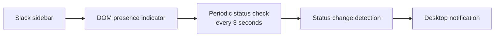

# Slack Presence Notifier

A background Tampermonkey userscript that monitors the rendered presence indicator for one configured Slack account and creates a desktop notification when the observed state changes.

This portfolio version is based on the original working userscript. It keeps the original DOM-based approach, polling interval, exact-name matching, contradictory-indicator handling, missing-target handling, and `GM_notification` integration. The target is now a generic configuration value rather than a role-specific or personal name.

> This project has no standalone graphical user interface, dashboard, or web control panel. Its primary artifact is the root-level `slack-presence-notifier.user.js` file, which runs in the background of an authorized Slack browser tab through Tampermonkey.

## License

The original userscript, demo, tests, and repository documentation are licensed under the MIT License. See [LICENSE](LICENSE).

The MIT License does not grant rights to Slack's service, interface, trademarks, user data, or Tampermonkey. Those third-party services and any browser-provided notification features remain subject to their own terms and permissions.

## Problem solved

Slack does not provide a built-in desktop notification for every presence transition of a selected account. This project demonstrates browser automation that observes the visible Slack sidebar in the background and turns a verified active/away transition into a local desktop notification.

## Features

- Checks the rendered Slack sidebar every 3 seconds.
- Finds non-self presence indicators using `data-qa="presence_indicator"` and `data-qa-presence-self="false"`.
- Matches the configured account by exact visible name, case-insensitively.
- Reads `data-qa-presence-active="true"` as active and `"false"` as away.
- Announces the initial state once.
- Notifies only when the observed state changes.
- Ignores contradictory matching indicators instead of guessing.
- Logs a missing-target event once until the target reappears.
- Keeps status parsing, DOM discovery, transition handling, and notification delivery in one reusable core.
- Sends no data to an external server.
- Includes a separate synthetic development/testing demo that does not require Slack or a Slack account.

## Technology

- JavaScript
- Tampermonkey userscript metadata
- Browser DOM APIs and `setInterval`
- Tampermonkey `GM_notification`
- Node.js built-in test runner
- Synthetic HTML demo data

## How it works

1. The monitor queries the rendered Slack sidebar for non-self presence indicators.
2. For each candidate, it walks up to seven parent levels and accepts only a row containing the exact configured visible name.
3. It reads all valid active/away attributes from the matching indicators.
4. If the matching indicators disagree, the monitor preserves the previous state and sends no notification.
5. If the state is consistent, the monitor emits an initial-state or status-changed event and calls `GM_notification` when appropriate.



Example transition notifications:

```text
The configured user is now ACTIVE.
The configured user is now AWAY.
```

The userscript has no in-page controls or rendered application screen. Tampermonkey runs it while the Slack tab is open, and the browser supplies the desktop notification surface.

The reusable implementation is in `src/presence-monitor.js`. The distributable `slack-presence-notifier.user.js` file is generated by combining that core with `src/userscript-entry.js`.

## Installation with Tampermonkey

1. Install the Tampermonkey browser extension.
2. Open the root-level `slack-presence-notifier.user.js` file in an editor.
3. Set `targetName` in the configuration object to the exact visible name of the account you are authorized to monitor.
4. Copy the complete file into a new Tampermonkey userscript, or open it from the local filesystem and install it.
5. Open the matching Slack workspace in a browser tab.
6. Check the browser console for a configuration error or the initial monitoring message.

If the source core or entry file changes, rebuild the single-file userscript:

```bash
npm run build:userscript
```

The generated file is intentionally kept at the repository root so it can be reviewed and installed directly.

## Configuration

The generated userscript contains a deliberately invalid placeholder:

```js
targetName: "CHANGE_ME"
```

Replace it with the exact visible account name before installing. The polling interval is `3000` milliseconds and can be changed in the same configuration object if needed. Do not add tokens, cookies, workspace identifiers, or personal data to the repository.

## Development / Testing Demo

`demo/index.html` is a development/testing simulation of the shared status-processing logic. It uses a synthetic member row with the same `data-qa` attributes as the observed Slack markup and never connects to Slack.

This page is not the userscript's interface, not a product dashboard, and not part of the background runtime. It only makes DOM changes and notification events visible without a real Slack account.

```bash
python3 -m http.server 8080
```

Open `http://localhost:8080/demo/`, then use **Set Active** and **Set Away**. The buttons update the synthetic DOM and trigger an immediate check; the monitor also continues its normal 3-second polling. The page displays notification events and ignored-state events.

No production UI screenshot is included: the actual userscript has no graphical interface. The demo is intentionally documented as a secondary testing aid rather than as the application itself.

## Limitations

- Slack's rendered DOM is an implementation detail. Changes to selectors, attributes, nesting, virtualization, or visible labels can break detection.
- Exact-name matching depends on the account name being rendered as a text node in the same sidebar row as the indicator.
- A contradictory set of matching indicators is ignored by design; it does not attempt to resolve which indicator is authoritative.
- The script only observes the currently rendered browser page and does not query a Slack API.
- Notifications depend on Tampermonkey permissions and browser desktop-notification settings.
- The script is not a background service and requires an open, loaded Slack tab.
- There is no standalone application window or dashboard; Tampermonkey and the browser provide the runtime and notification surface.

### DOM compatibility verification

The automated checks validate the reusable status-processing logic and the synthetic development demo. Current Slack DOM compatibility is a separate, authorized-environment check: if Slack changes its rendered selectors, attributes, nesting, virtualization, or visible labels, the userscript must be reviewed before real use. No real colleague's status was used for this portfolio validation.

## Privacy and authorized use

This project performs local DOM observation and local desktop notification only. It does not transmit presence data, use Slack tokens, read cookies, or call an external server.

Use it only with your own account, a synthetic/demo environment, or an account and workspace where you have explicit authorization to monitor the rendered presence. Do not use it to bypass access controls, collect private information, or monitor people without permission. Respect Slack's terms, workplace policies, and applicable privacy law.

## Future improvements

- Support an explicit selector adapter when Slack markup changes.
- Add browser-level tests for the Tampermonkey wrapper and notification permissions.
- Add a configurable notification cooldown for repeated browser events.
- Add clearer browser notification-permission diagnostics.
